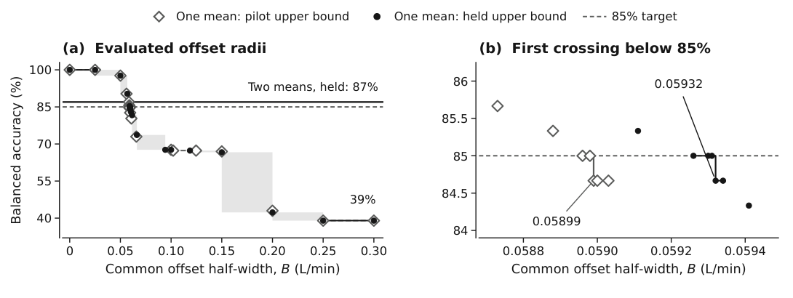

# Hydraulic pump leakage diagnosis from one or two flow windows

Analysis code, cycle-level results and figures for *When Is a Second Flow-Averaging Window Needed to Distinguish Internal Leakage Levels in a Hydraulic Pump?* by Minsu Jo, Namhyun Yoo, Beomseok Kim, Hoansuk Choi and Jinhong Yang.

On ten held-out ZeMA operating conditions, a single five-second mean could guarantee the correct leakage grade on at most **117 of 300 cycles** under an assumed cycle-specific zero offset of up to ±0.30 L/min. The fixed difference between two synchronized means guaranteed **261 of 300**. The bound is computed for this finite panel. The installed meter's actual offset and three-grade transfer to another physical pump remain unmeasured.



| Analysis | One window | Two windows | Inspect the evidence |
|---|---:|---:|---|
| Held-out ZeMA, ±0.30 L/min shared within each cycle | 39.00% upper bound | 87.00% attained | [Cycles](runs/u-confirm-01/panel.csv) · [exact 85% crossing](runs/u-confirm-01/critical-offset.json) |
| 38 held-out development conditions, same offset assumption | 41.58% upper bound | 83.42% attained | [Condition-wise results](runs/u-paper-groups-01/groups.csv) |
| ZeMA exploratory panel, centered waveforms, 50 samples by 54.9 s | 75.67% | 99.00% | [Model results](runs/u-followup-c/result.json) |
| Same waveforms, gain ±0.25% and per-window error ±0.005 L/min | 75.33% | 85.33% | [Error grid](runs/u-wave-gain-region/results.json) · [85% frontier](runs/u-wave-gain-axis-audit/frontier-refined.json) |
| PONAR binary valve-plate diagnosis on independent dates, refitted waveforms | 48.10% | 40.00% | [External predictions](runs/u-ponar-public-transfer/predictions.csv) |

The ceiling includes every deterministic classifier of a single admissible mean. The two-mean rule uses two means of 50 readings each. The waveform comparison fixes the total at 50 readings and the deadline at 54.9 s. One design takes all readings in the late phase, while the other takes 25 in each phase. On PONAR the fault labels, sampling rate and load cycle differ.

## Run the main result

Clone or open this repository, then run these commands from its root with Python 3.10 or later. Both use the standard library and the included records.

```sh
git clone https://github.com/JoMinsu-KU/hydraulic-flow-windows.git
cd hydraulic-flow-windows
python replay_primary.py
python replay_appendices.py
```

The primary replay reports **261** correct cycles for two means and a ceiling of **117** for one mean. The ceiling crosses the 85% target between **255/300 at 0.05931 L/min** and **254/300 at 0.05932 L/min**. The appendix replay checks the published tables against the archived predictions and numerical decisions.

## Refit models and rebuild figures

The optional computations below were tested with Python 3.12. Install the packages using `python -m pip install -r requirements.txt`. Obtain the raw flow archives directly from [UCI (ZeMA hydraulic test rig)](https://doi.org/10.24432/C5CW21) and [the PONAR valve-plate data release](https://www.kaggle.com/datasets/mbjunior/valve-plate-failure-prediction-in-hydraulic-pumps). Replace the two example file paths with the downloaded archive locations.

```sh
python replay_primary.py --archive /path/to/uci447.zip
python replay_waveforms.py --archive /path/to/uci447.zip
python replay_joint_error.py --archive /path/to/uci447.zip
python replay_ponar.py --archive /path/to/ponar-valve-plate-v1.zip
python manuscript/ieee-access/figures/make_figures.py --out regenerated
python manuscript/ieee-access/figures/make_phase_evidence.py --runs runs --out regenerated/phase-evidence.pdf
```

The primary raw-data replay recomputes 3,600 held-out means and the three training medians. The waveform scripts reproduce the matched 50-sample comparison and the specified joint-error case. The PONAR replay refits four forests and compares 9,620 prediction records. The four published vector figures are available in [figures/](figures/). For the event search, error certificates, condition splits, field-validation limits and data attribution, see the [results and provenance guide](RESULTS.md).

## Files

- [Cycle assignments](cycle_split.csv) and [confirmation settings](protocols/confirmation-lock.json)
- [Numerical results and predictions](runs/) and [independent checks](review/)
- [Computational procedures and expected outputs by appendix](RESULTS.md)
- [SHA-256 file manifest](checksums.sha256). With GNU coreutils, run `sha256sum --check checksums.sha256` from the repository root.
